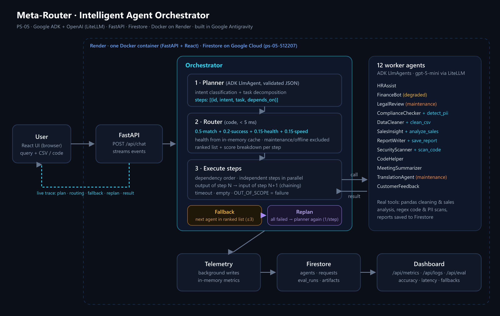

# Meta-Router: Intelligent Agent Orchestrator

**atomcamp National AI Hackathon Finale · PS-05**

One entry point for 12 specialist AI agents. The user types a request in plain language. A **planner** understands it and splits it into steps, a **router** picks the best healthy agent for each step, an **orchestrator** chains the steps and reroutes on failure, and a live **dashboard** shows every decision.

> In the dataset's own historical logs, only **18 of 200 requests (9%)** reached the right agent and 25% had to be rerouted.

**Live demo:** https://hackathon-final-khi.onrender.com  ·  **Team:** Muhammad Ali · Hammad-Ullah



## Architecture (text version)

```
User (browser) ── query + optional attachment (CSV / code / text)
   │
   ▼
FastAPI /api/chat ── streams one JSON event per line
   │
   ▼
Orchestrator
   1. Planner (ADK LlmAgent, JSON validated with Pydantic)  → steps [{id, intent, task, depends_on}]
   2. For each step (dependency order, independent steps in parallel):
        Router (code, <5 ms) ranks agents → try best → on failure next agent (max 3)
        all failed → Replanner proposes replacement steps (1 per step, 2 per query) → else partial result
   3. Outputs (and cleaned data) flow into dependent steps (chaining)
   │
   ▼
12 worker agents (ADK LlmAgents, OpenAI via LiteLlm) + real tools
   │
Telemetry (background) ──► Firestore ──► /api/metrics, /api/logs ──► React dashboard
```

### Routing

```
score = 0.5 × match + 0.2 × success_rate + 0.15 × health + 0.15 × speed
match   from data/intent_map.json (primary 1.0, backups 0.3–0.7)
health  active 1.0 · degraded 0.5 · maintenance / offline → excluded
speed   1 − avg_response_time / slowest agent's avg_response_time
```
Routing runs in code, not by an LLM choosing: it's fast, cheap, predictable and explainable, fallback is guaranteed, and every decision has a score breakdown. The LLM does what it's best at: understanding the request.

### Failure handling
- **Failure** = exception, timeout, empty output, or the agent replying `OUT_OF_SCOPE: <reason>`. Each one moves to the next agent in the ranked list.
- **Unavailable** agents (maintenance / offline) are skipped before calling, so they add no latency. LegalReview and TranslationAgent are in maintenance in the dataset, so legal and translation requests fall back for real.
- **Replan**: if every agent for a step fails, the planner is called again with the failure context and the agents currently available. It replaces only that step. If that also fails, the user gets a partial result with a clear explanation.

### Real tools
| Tool | Agent | What it does |
|---|---|---|
| `clean_csv` | DataCleaner | pandas: trim, unify casing, normalize mixed date formats, drop duplicates, fill missing values |
| `analyze_sales` | SalesInsight | totals, top products, revenue by region, monthly trend |
| `save_report` | ReportWriter | saves Markdown report to Firestore `artifacts`, returns download link |
| `scan_code` | SecurityScanner | regex scan for exposed keys, `eval`, SQL concatenation, `verify=False` … |
| `detect_pii` | ComplianceChecker | emails, Pakistani phone numbers, CNIC numbers |

Attachments are passed to tools through ADK session state, so the LLM never copies large files into tool calls. The cleaned CSV from DataCleaner is chained into the next step automatically.

## Tech stack
Google ADK (Python) · OpenAI `gpt-5-mini` via LiteLLM · FastAPI · pandas · Firestore (Google Cloud) · Docker on Render · React + TypeScript + Vite + Tailwind + Recharts · built in Google Antigravity.

## What we enriched in the data
- `data/original/` keeps the two given files **untouched**.
- `data/ps05_agent_registry_enriched.json`: same fields and format. Only `description` and `capabilities` were rewritten, because they were placeholders (`cap_1`…). Status, success rate, response time and usage are unchanged.
- `data/intent_map.json`: the 10 dataset intents plus `security_scan` and `customer_feedback` (SecurityScanner and CustomerFeedback had no intent).
- `data/test_single.csv` (32 realistic queries) and `data/test_compound.csv` (10 multi-step queries) were added because the given query text is synthetic ("Sample query about hr policy topic #1").
- `data/demo_sales.csv` and `data/samples/` hold demo attachments. **Intent labels were never changed.**

## Evaluation
Local run on 20 Oct 2026, `gpt-5-mini`, real LLM calls (re-run on the deployed version before presenting).

| Metric | Result | Notes |
|---|---|---|
| Routing accuracy, 32 realistic queries | **100%** (32/32) | baseline in the dataset's logs: **9%** |
| Routing accuracy, 200 original queries | **98%** (196/200) | 4 synthetic queries declined as unsupported |
| Agent accuracy (best available agent chosen) | **100%** / **98%** | maintenance agents count as correctly skipped |
| Compound task completion, 10 multi-step queries | **100%** (10/10) | earlier runs 70–80%; fixed a cold-start planner timeout and planner adding unrequested steps (the planner prompt was tuned on these failures) |
| Latency overhead vs direct agent call | **+3.1 s** avg (10 queries) | planner ≈ 1.5 s, routing < 5 ms; direct 6.4 s → orchestrated 9.5 s |
| Avg latency, compound query | 15.4 s | 2–3 agent calls in sequence |

Run from the Evaluation page or `cd backend && python -m eval.run_eval realistic|original|compound`.

## Run locally
```bash
# backend
cd backend
python -m venv .venv && .venv/Scripts/activate      # macOS/Linux: source .venv/bin/activate
pip install -r requirements-dev.txt
cp ../.env.example .env                             # fill OPENAI_API_KEY (GOOGLE_CLOUD_PROJECT optional)
uvicorn app.main:app --reload --port 8000
pytest -q tests

# frontend (second terminal)
cd frontend && npm install && npm run dev            # http://localhost:5173, /api proxied to :8000
```
Without `GOOGLE_CLOUD_PROJECT` the backend uses an in-memory store, so no GCP is needed for development.

## Deployment
- **Hosted on Render** as a single Docker container: FastAPI serves the API under `/api` and the React build at `/` (one URL, no CORS). One uvicorn worker, because agent statuses and metrics are cached in memory.
- **Database: Firestore on Google Cloud** (project `ps-05-512207`). On Render the service-account key is a secret file (`GOOGLE_APPLICATION_CREDENTIALS=/etc/secrets/firebase-key.json`); locally it uses Application Default Credentials. Agents are seeded automatically on first start.
- **Built in Google Antigravity** with Google ADK.
- `/api/health` is a free, instant uptime probe (no LLM or database calls); UptimeRobot pings it every 5 minutes so the free instance stays awake.
- The same Dockerfile deploys to Google Cloud Run with one command:
  ```bash
  gcloud run deploy meta-router --source . --region us-central1 --allow-unauthenticated
  ```

Setup steps: [DEPLOY_RENDER.md](DEPLOY_RENDER.md). Environment variables: `OPENAI_API_KEY`, `MODEL_NAME`, `GOOGLE_CLOUD_PROJECT`, `STEP_TIMEOUT_S`, `GOOGLE_APPLICATION_CREDENTIALS` (or `FIREBASE_CREDENTIALS_JSON`).

## Scalability
- A new agent = one registry entry + one intent-map line. No code changes.
- Hundreds of agents: embedding search picks top candidates, the router scores only those.
- A small classifier for simple single-intent queries, with the LLM planner only for compound or unclear ones, cuts most of the overhead.
- Pub/Sub for long-running jobs; autoscaling containers (e.g. Cloud Run); learn routing weights from user satisfaction data.

## Presentation
Script, demo steps and Q&A prep: [docs/PRESENTATION.md](docs/PRESENTATION.md).

## Repository layout
```
backend/app/        main.py · config.py · schemas.py · db.py · llm.py · router.py · orchestrator.py · telemetry.py
backend/app/agents/ planner.py · workers.py · tools.py
backend/eval/       run_eval.py
backend/tests/      router + tools unit tests
frontend/src/       pages (CommandCenter, Registry, Dashboard, Evaluation) · components · api/client.ts
data/               original/, enriched registry, intent map, test sets, demo files
```
